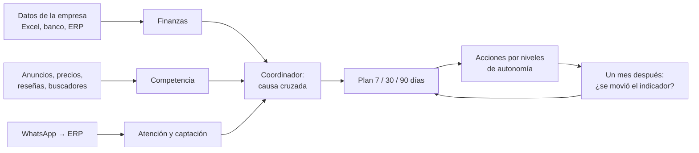

<p align="center"></p>

# Vigía — un equipo de agentes de IA para toda tu pyme

**Encuentra por qué una pyme pierde dinero o clientes, cruzando lo que ve cada área, y actúa**: reclama cobros, valida precios, propone el plan a 7, 30 y 90 días y, un mes después, **mide si funcionó**.

> **Cada proveedor ve su parte. Vigía ve la causa.**

Proyecto del equipo EscuadronMCP para el hackathon **IA First** de Talent Land España (Málaga, 24–25/11/2026), reto **04 «La IA como servicio: agentes inteligentes que actúan»**.

> **Para el jurado:** entregables en [`docs/entrega/`](docs/entrega/) (canvas, uso de la IA, marketing y guion del pitch en PDF) · **Guía de la demo:** [`docs/DEMO.md`](docs/DEMO.md) · **Estado:** [`docs/ESTADO.md`](docs/ESTADO.md) · **Uso de la IA:** [`docs/uso-ia.md`](docs/uso-ia.md)

---

## 1. Cómo usarlo: ver la demo en 5 minutos

### Requisitos
- [**uv**](https://docs.astral.sh/uv/getting-started/installation/), que instala por sí solo Python 3.13 y las dependencias exactas.
- Opcional: una clave de Anthropic. **Sin clave, Vigía funciona igual en modo reglas** (misma demo, reproducible).

### Instalación (una vez)

```bash
git clone https://github.com/telee04maro/DiverxiaEscuadronMCP.git
cd DiverxiaEscuadronMCP
uv sync
cp .env.example .env      # Windows (PowerShell): Copy-Item .env.example .env
```

El archivo `.env` nunca se sube al repositorio (un test lo vigila). Si quieres Claude, escribe ahí `ANTHROPIC_API_KEY`.

### Arrancar

```bash
uv run streamlit run src/vigia/app.py      # panel en http://localhost:8501
```

Pulsa **«Analizar con el equipo de agentes»** y recorre las pestañas:

| Pestaña | Qué verás |
|---|---|
| 1 · Empresa | La clínica de ejemplo (ficticia) o **«Tu empresa»**: entrevista + tus Excel/CSV con plantillas |
| 2 · Especialistas | Lo que ve cada agente, con su evidencia: caja para 9 días, oferta de la competencia a 20 €, 59 % de consultas fuera de horario… |
| 3 · Coordinador | **La causa cruzada**, de qué especialistas sale y las hipótesis descartadas («no es la temporada») |
| 4 · Acciones | El plan a 7/30/90 días: lo que hace solo, lo que espera tu aprobación y lo que va a una persona |
| 5 · Un mes después | Qué indicadores se movieron. Un cobro solo cuenta si **aparece en el banco**; lo demás dice «coincide», no «lo causó», y lo que no se hizo no se mide |
| 6 · Registro y uso de IA | Qué vio, decidió e hizo cada agente, y el coste de cada llamada a Claude |
| 7 · ERP y WhatsApp | El asistente de WhatsApp registra consultas en el ERP de demo **sin duplicar** |
| 8 · Clientes (CRM) | **Una ficha por cliente** con lo que sabe cada agente (deuda, consultas, reclamaciones), unida por correo o teléfono. Si un cliente debe dinero y tiene una consulta sin atender: «contéstale antes de reclamarle» |

| Quiero… | Comando |
|---|---|
| El mismo recorrido en la consola | `uv run python -m vigia` |
| Forzar modo reglas aunque haya clave | `VIGIA_USE_AI=0` en `.env` |
| La API del ERP de demo para el asistente de WhatsApp | `uv run python -m vigia.connectors.http_api` (`VIGIA_ERP_TOKEN` obligatorio) |
| Regenerar la clínica sintética | `uv run python -m vigia.data.synthetic` |
| Probar la clave de BALTER (solo lectura, con visto bueno) | `uv run python -m vigia.connectors.balter_probe --autorizado` |

---

## 2. Qué hace (para quien no ha visto el código)

### Qué problema resuelve
La gestión de una pyme está repartida: la gestoría ve los impuestos, la agencia las redes, el Excel las cuentas. **Nadie cruza la información**, así que los problemas se detectan tarde y se atacan por el lado equivocado.

### El caso de la demo: una clínica de fisioterapia de Málaga (ficticia)

| Agente | Fuentes propias | Qué ve |
|---|---|---|
| 💶 **Finanzas** | Facturas, extracto bancario, sesiones por mes | Caja para **9 días**; **10.554 €** vencidos; una aseguradora paga a 95 días; particulares **−15,4 %**, no estacional |
| 🔎 **Competencia y mercado** | Anuncios de Meta, precios, reseñas, buscadores | La clínica de al lado anuncia **primera sesión a 20 €** desde hace 18 días; el **86 %** de las reseñas recientes se quejan de la espera |
| 💬 **Atención y captación** | Consultas del ERP/CRM (escribe el asistente de WhatsApp) | **59 %** de las consultas llegan fuera de horario, tardan **12 h** frente a 0,4 h y se pierde el **41 %** frente al 0 % |
| 🧭 **Coordinador** | Los hallazgos de los tres | **Causa:** se pierden particulares por precio y por espera, también de noche, y la caja no aguanta una guerra de precios |

**El plan:** reclamar a la aseguradora (7 días), activar el asistente de WhatsApp fuera de horario, contraoferta a **30 €** — finanzas comprobó que a 20 € no deja margen — (30 días) y reorganizar la agenda (90 días). Después, medir.

### Actúa, con control

| Nivel | Ejemplos |
|---|---|
| **Actúa solo** | Recordatorio amable de pago |
| **Propone y una persona aprueba** | Reclamación formal, precios, campañas, activar el asistente |
| **Lo hace una persona, con fecha** | Asignar consultas, responder reseñas |
| **Deriva a un experto** | Previsión de caja con el asesor |

Los correos se identifican como escritos por IA, nunca se envían dos veces y en la demo van a `outbox/` (o solo a un buzón de prueba).

### Verificación honesta
- **Las reglas calculan; la IA interpreta.** Dinero, plazos y prioridad son código determinista con `Decimal`.
- **Desconocido no es cero:** lo que falta aparece como «sin datos» o «lo que me falta».
- **Una acción no es una prueba:** una factura solo se da por cobrada si **el pago cuadra con el banco**; el resto de indicadores dice «coincide», no «lo causó».
- **Todo lo que propone la IA se valida:** un precio que no está en el anuncio, una causa que cita un hallazgo inexistente o un correo con un importe inventado se rechazan; una salida fuera del esquema vuelve al modo reglas.

---

## 3. Coste, adaptación y seguridad

### 💶 Es barato (medido con Claude real el 24/11/2026)

| Concepto | Coste |
|---|---|
| **Un análisis** (Haiku 5.5 lee anuncios y reseñas, Opus 5.5 cruza) | **0,04 $**, 14–20 s, 3 llamadas |
| Recorrido completo con 2 correos redactados por Claude | **0,067 $**, 6 llamadas |
| **Por empresa y mes** (un análisis semanal) | ≈ **0,30 $**, frente a una suscripción desde 99 € |
| Tope de gasto por ejecución | `AI_BUDGET_USD` (0,50 $); al alcanzarlo, reglas |
| Sin clave de IA | 0 $: misma demo en modo reglas |

**Lo que escribe Claude se comprueba contra los datos:** cada cifra (con su unidad), cada fecha; una cuenta bancaria, un enlace o un teléfono que no estén en los datos descartan el texto. Con Claude real, 3 causas y 2 correos aceptados y ninguno descartado; con textos inventados, los tests demuestran que se descartan. Claude no ve los nombres de quien debe dinero ([datos personales](docs/datos-personales.md)).

### 🧩 Se adapta a cada empresa
- **«Tu empresa»:** entrevista inicial y Excel/CSV con plantillas en español (facturas, banco, ventas, consultas, reseñas, competidores). Cada fila se valida; los errores salen como avisos con su número de fila.
- **ERP/CRM:** mediante el contrato `CrmConnector`. El ERP de demo tiene la forma de BALTER y una API con token para el asistente de WhatsApp ([contrato](docs/integracion-whatsapp-erp.md)).
- **BALTER real:** su API v1 no permite leer oportunidades, así que hoy entran por exportación a «Tu empresa». La clave se probó en solo lectura (HTTP 200) sin tocar datos personales ([ADR 006](docs/decisiones/006-api-balter.md)).
- **Un especialista nuevo** se añade implementando `Specialist` y registrándolo en `pipeline.default_specialists()`, sin tocar el coordinador.

### 🔒 Seguridad
- Credenciales solo en `.env`; un test impide que la plantilla `.env.example` lleve secretos.
- **Datos 100 % sintéticos:** clínica, aseguradoras y competidores son ficticios, como exigen las bases.
- Lo que llega de terceros (anuncios, reseñas) es dato, nunca instrucción: el sistema prohíbe obedecer órdenes escondidas.
- La API del ERP escucha solo en `127.0.0.1` por defecto, exige token y nunca devuelve trazas.

---

## 4. Cómo funciona (vista general)



### Glosario

| Término | Significado |
|---|---|
| **Hallazgo** | Lo que ve un especialista, con su evidencia (dato, fuente y fecha), confianza, impacto, esfuerzo y urgencia |
| **Causa cruzada** | Una explicación que solo aparece al juntar hallazgos de varias áreas |
| **Re-medición** | Comprobar un mes después si el indicador objetivo de cada acción se movió |
| **Modo reglas** | Funcionamiento sin IA: mismos cálculos, textos fijos |
| **Ficha única de cliente** | Lo que sabe cada agente de un mismo cliente, unido por correo o teléfono (pestaña 8) |

---

## 5. Entregables

| Entregable | Archivo |
|---|---|
| 1 · Canvas del modelo de negocio | [`docs/entrega/1-lienzo.pdf`](docs/entrega/1-lienzo.pdf), detalle en [`1-canvas-detalle.pdf`](docs/entrega/1-canvas-detalle.pdf) |
| 2 · Prototipo y uso de la IA | **este repositorio**, [`docs/entrega/2-prototipo.pdf`](docs/entrega/2-prototipo.pdf) (capturas del panel) y [`2-uso-de-la-ia.pdf`](docs/entrega/2-uso-de-la-ia.pdf) |
| 3 · Marketing (logo, eslogan, estrategia) | [`docs/entrega/3-marketing.pdf`](docs/entrega/3-marketing.pdf), [`3-logo.png`](docs/entrega/3-logo.png) |
| 4 · Guion del pitch | [`docs/entrega/4-guion-del-pitch.pdf`](docs/entrega/4-guion-del-pitch.pdf) |

**Herramientas y componentes declarados:** Claude Opus 5.5 y Haiku 5.5 (producto), Claude Code (construcción, registrado en [`docs/uso-ia.md`](docs/uso-ia.md)), Python 3.13, Streamlit, Pydantic, pandas, SQLite. El asistente de WhatsApp (Hermes) es un componente previo de un miembro del equipo.

---

## 6. Para el equipo técnico

### Más allá de lo pedido

| Aportación | Por qué importa | Dónde verlo |
|---|---|---|
| **Coordinador que cruza tres áreas** y descarta hipótesis | Es la tesis: la causa que nadie ve por separado | `coordinator/causes.py` |
| **Agentes que se contrastan** | La contraoferta solo se propone si finanzas confirma margen | `finance/`, `coordinator/plan.py` |
| **Conciliación con el banco** (y un fallo inyectado en los tests) | Una acción no se da por hecha sin su efecto | `finance/`, `remeasure.py` |
| **Salidas de IA comprobadas contra los datos** | Ni una cifra, fecha, cuenta o enlace inventados llegan al usuario o a un cliente | `domain/grounding.py`, `coordinator/causes.py`, `actions/collections.py` |
| **Datos personales al mínimo** | Reseñas sin nombres ni contactos; Claude no ve a los morosos; borrado real | `domain/privacy.py`, [`docs/datos-personales.md`](docs/datos-personales.md) |
| **Tres rondas de red team** (R1: 8 P1; R2: 18 hallazgos; R3: 8 P1 y 9 más, todos corregidos) | Auditoría independiente con test de aceptación por hallazgo | `tests/test_red_team*.py`, [`docs/red-team.md`](docs/red-team.md) |
| **Rendimiento medido con oha** | API del ERP: 1.562 pet./s sin rechazos con 50 a la vez (antes 774 y 17 rechazos) | [`docs/ESTADO.md`](docs/ESTADO.md) |

### Calidad

```bash
uv run ruff format . && uv run ruff check .   # formato y lint
uv run mypy src tests                         # tipado estricto
uv run pytest                                 # 177 tests, incluido el recorrido de extremo a extremo
```

La CI (`.github/workflows/ci.yml`) los ejecuta en cada push, en Linux y en Windows.

### Decisiones de arquitectura
- [001 · Idea inicial](docs/decisiones/001-idea-y-enfoque.md) (sustituida)
- [002 · Vigía: especialistas y coordinador](docs/decisiones/002-vigia-equipo-de-agentes.md)
- [003 · Stack del prototipo](docs/decisiones/003-stack-del-prototipo.md)
- [004 · Cambio de nombre a Vigía](docs/decisiones/004-nombre-vigia.md)
- [005 · Conectores ERP/CRM, atención y captación, y entrada de datos](docs/decisiones/005-conectores-y-captacion.md)
- [006 · Qué permite la API de BALTER](docs/decisiones/006-api-balter.md)
- [007 · CRM de Vigía: ficha única de cliente](docs/decisiones/007-ficha-unica-de-cliente.md)

### Estructura

```
src/vigia/
  domain/          Contrato del hallazgo, dinero (Decimal), prioridad, vocabulario por sector,
                   comprobación de la IA contra los datos y privacidad
  data/            Modelo de la empresa, carga, entrada «Tu empresa» y clínica sintética
  specialists/     Finanzas, competencia y atención y captación (interfaz común)
  finance/         Conciliación con el banco y validación de ofertas
  coordinator/     Causa cruzada y plan a 7, 30 y 90 días
  actions/         Reclamaciones de cobro y envío de correo
  connectors/      Contrato ERP/CRM, ERP de demo, su API HTTP y prueba de BALTER
  llm/             Claude tras una interfaz (salidas estructuradas, tope de gasto, modo sin IA)
  crm.py           Ficha única de cliente (ADR 007)
  remeasure.py     Un mes después: ¿se movió el indicador?
  pipeline.py      El ciclo completo
  app.py           Panel de la demo (Streamlit)
data/demo/         Clínica sintética: antes (mes-0) y un mes después (mes-1)
docs/              Reto, decisiones (ADR), fuentes, uso de la IA, demo, negocio y entrega
```
