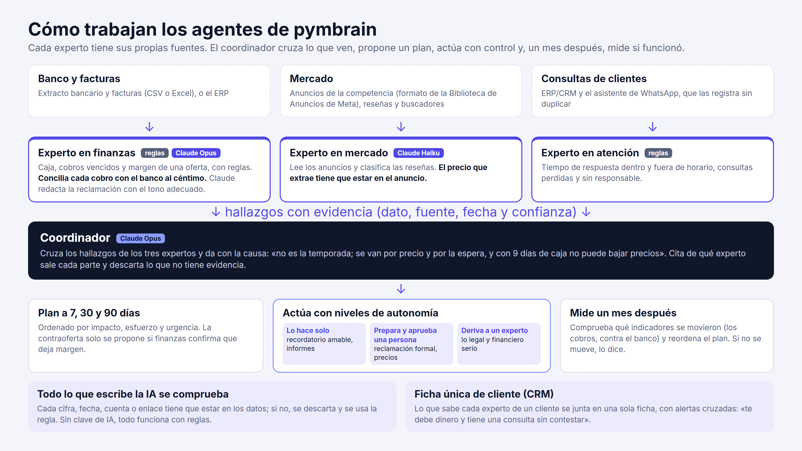
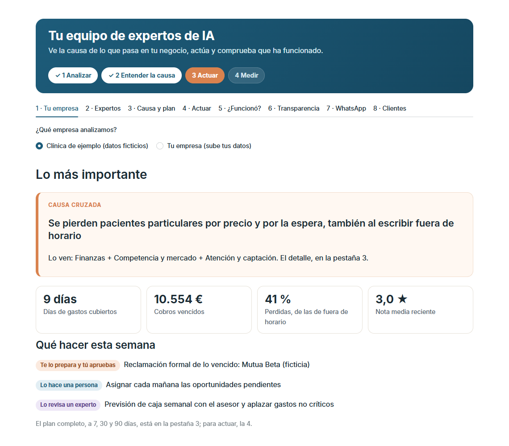
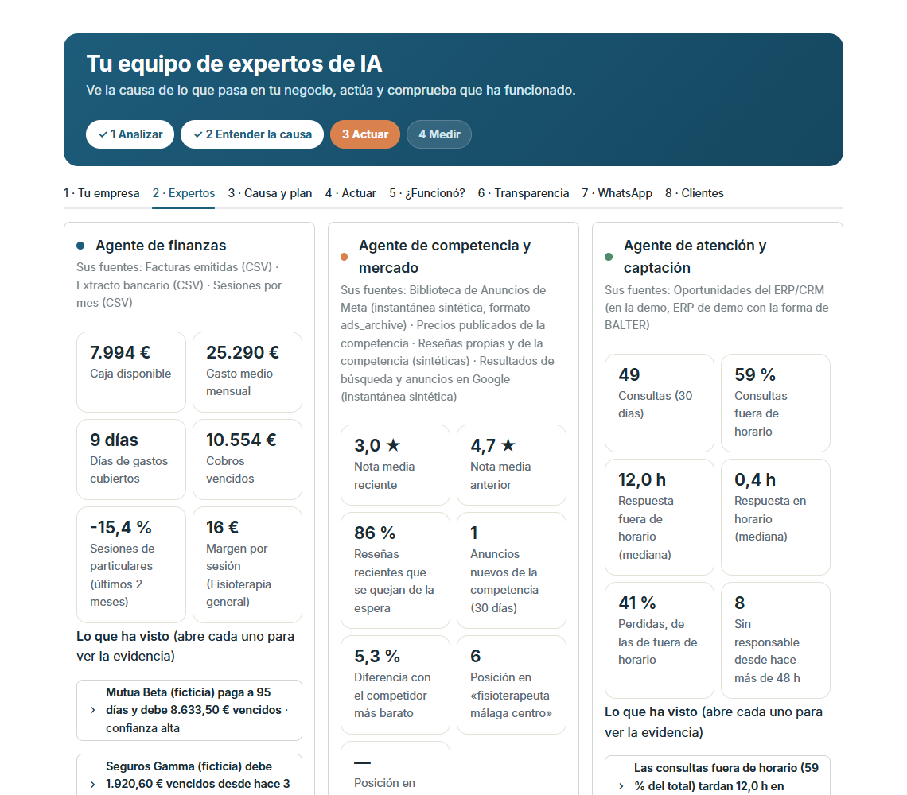
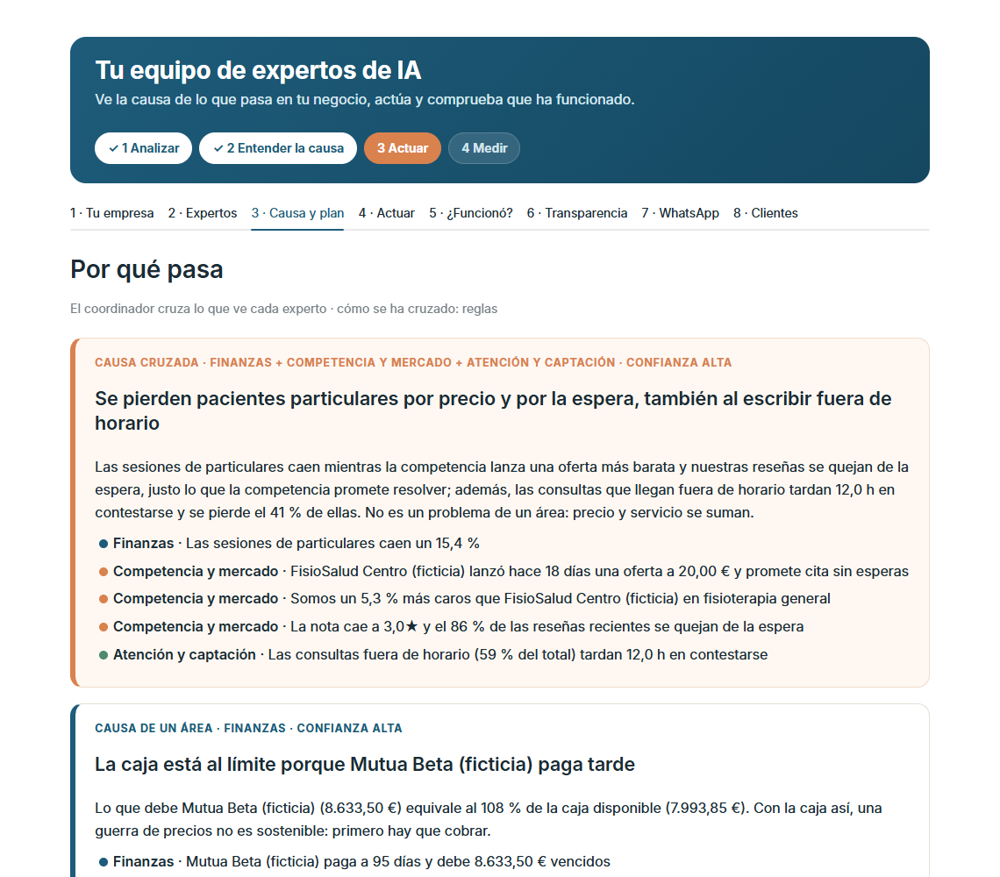
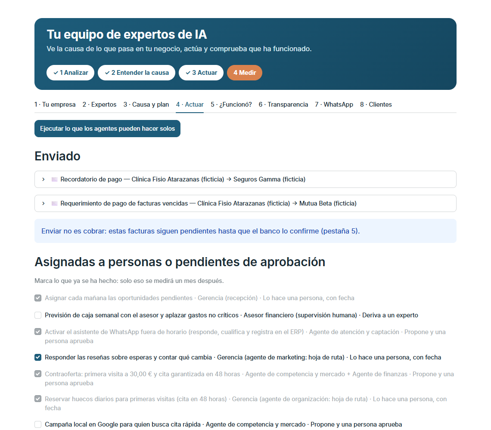
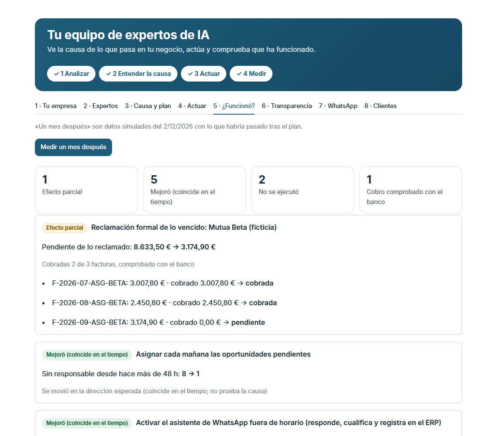
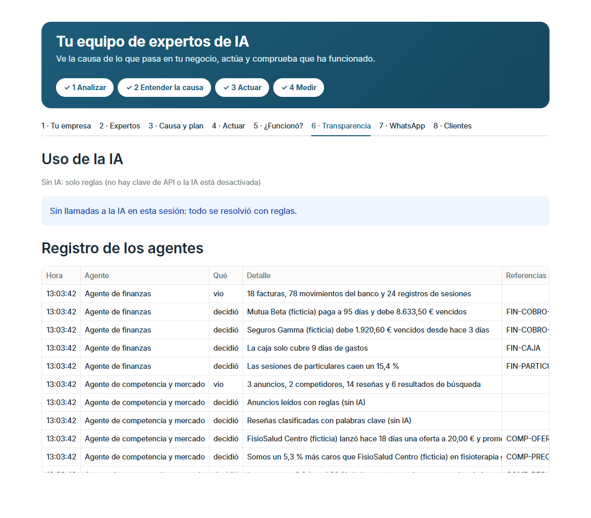
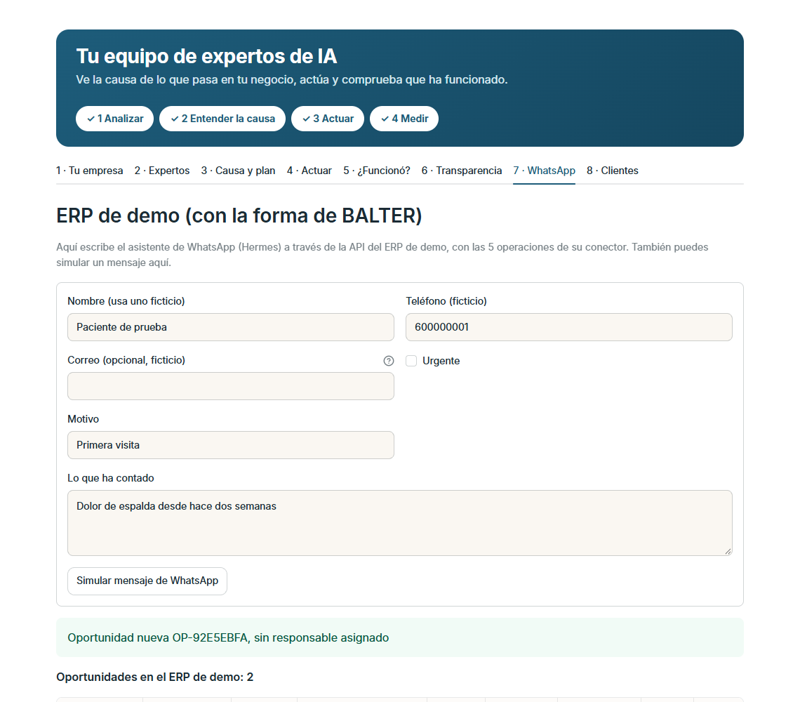
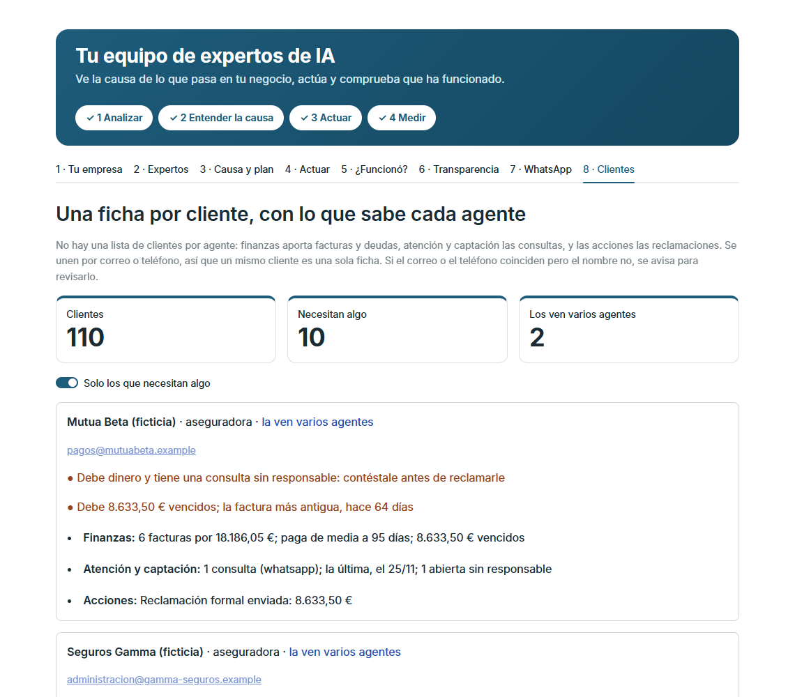

# Entregable 2 · Prototipo y uso de la IA

**pymbrain** es un equipo de expertos de IA para la pyme: cada experto vigila una parte del negocio con sus propias fuentes, un coordinador cruza lo que ven para encontrar la causa real de un problema, propone un plan, actúa con control y, un mes después, mide si funcionó.

Este documento explica, como piden las bases, **cómo se usa la IA dentro del producto**, **cómo la hemos usado para construirlo** y **qué herramientas, modelos y datos** hemos empleado. El prototipo funciona: el código está en el repositorio y se prueba en cinco minutos (`uv sync` y `uv run streamlit run src/vigia/app.py`).

## 1. Cómo trabajan los agentes

| Agente | Fuentes propias | Qué calcula con reglas | Dónde entra la IA | Qué hace |
|---|---|---|---|---|
| **Finanzas** | Extracto bancario y facturas (CSV o Excel) o el ERP | Caja y días que cubre, cobros vencidos por cliente, días de cobro, caída de ventas no estacional, margen de una oferta | **Claude Opus** redacta la reclamación de cobro con el tono adecuado a cada cliente | Reclama cobros (lo amable, solo; lo formal, con aprobación) y da una factura por cobrada **solo si el pago cuadra con el banco al céntimo** |
| **Competencia y mercado** | Anuncios de la competencia (con el formato de la Biblioteca de Anuncios de Meta), reseñas y resultados de búsqueda | Diferencia de precio, nota media, posición en el buscador | **Claude Haiku** lee los anuncios (oferta, precio, «sin esperas») y clasifica las reseñas por tema | Detecta la oferta que te quita clientes y de qué se quejan |
| **Atención y captación** | Consultas del ERP/CRM, que registra el asistente de WhatsApp | Tiempo de respuesta dentro y fuera de horario, consultas perdidas y sin responsable | Ninguna: todo son cálculos sobre datos | Detecta las consultas que se pierden y quién debe contestarlas |
| **Coordinador** | Los hallazgos de los tres expertos, cada uno con su evidencia (dato, fuente, fecha y confianza) | Prioridad por impacto, esfuerzo y urgencia; si una causa es «cruzada» lo decide el código según las áreas de los hallazgos | **Claude Opus** cruza los hallazgos, explica la causa y descarta las hipótesis sin evidencia | Plan a 7, 30 y 90 días; ejecuta lo seguro, pide aprobación para lo delicado y re-mide un mes después |
| **Ficha única de cliente (CRM)** | Lo que aporta cada agente sobre cada cliente | Une las piezas por correo o teléfono, sin duplicados | Ninguna | Avisa de cruces: «te debe dinero y tiene una consulta sin contestar; contéstale antes de reclamarle» |

**Autonomía por niveles**, visible en el panel:
- **Lo hace solo:** lo reversible y de bajo riesgo (recordatorio amable, informes).
- **Prepara y aprueba una persona:** reclamación formal, respuestas públicas, campañas y precios.
- **Deriva a un experto humano:** lo legal y financiero serio.

**El asistente de WhatsApp** (componente previo de un miembro del equipo, adaptado en el hackathon; `whatsapp-hack/`) contesta fuera de horario, pide nombre y correo, y registra **una** consulta por conversación en el ERP de pymbrain por su API, sin duplicar ni reintentar a ciegas. El agente de atención la mide.

## 2. El prototipo, pantalla a pantalla

Capturas del panel con el código entregado, en **modo reglas** (sin clave de IA). Con Claude real las cifras son las mismas: la IA solo cambia la redacción.

**1 · Tu empresa.** Lo más importante de un vistazo: la causa, los indicadores clave y qué hacer esta semana. La empresa puede ser la clínica de ejemplo o la tuya, subiendo tus Excel o CSV.

**2 · Expertos.** Lo que ve cada experto, con su evidencia. Aquí trabaja **Claude Haiku**: lee el anuncio de la clínica de al lado (20 €, «sin esperas») y clasifica las reseñas (el 86 % de las recientes se queja de la espera). El precio que extrae se comprueba contra el texto del anuncio.

**3 · Causa y plan.** El coordinador (**Claude Opus**) cruza los hallazgos: no es la temporada (el año pasado no bajó); se pierden pacientes por precio y por la espera, y con 9 días de caja una guerra de precios no es sostenible. Cita de qué experto sale cada parte. Debajo, el plan a 7, 30 y 90 días.

**4 · Actuar.** Lo que pymbrain hace solo y lo que espera aprobación. La reclamación formal la redacta **Claude Opus**; antes de enviarla se comprueba que aparecen cada factura y cada importe, y ninguno inventado. Todo mensaje se identifica como redactado por IA.

**5 · ¿Funcionó?** Un mes después (simulado, y se dice): los cobros se comprueban contra el banco al céntimo; el resto de indicadores «coincide en el tiempo», porque no prueba la causa. El plan se reordena.

**6 · Transparencia.** El registro de cada agente (qué vio, qué decidió, qué hizo y qué comprobó) y el uso de la IA: cada llamada, su modelo, sus tokens y su coste.

**7 · WhatsApp.** El ERP de demo al que escribe el asistente de WhatsApp: cada consulta, sin duplicar, sin responsable hasta que alguien la asigna.

**8 · Clientes.** La ficha única de cada cliente con lo que sabe cada agente, y las alertas cruzadas.

## 3. La IA dentro del producto: dónde, por qué y cómo se verifica

**Principio: las reglas calculan y la IA interpreta.** Cada uso de IA tiene detrás una regla que lo verifica o lo sustituye. Así el producto no inventa cifras, funciona sin clave de IA (modo reglas) y su coste está acotado.

| Uso | Modelo | Por qué aquí | Cómo se verifica | Si no hay IA |
|---|---|---|---|---|
| Leer los anuncios de la competencia | `claude-haiku-5-5` (esfuerzo bajo) | Texto libre y variado; clasificación barata en volumen | **El precio extraído tiene que aparecer literalmente en el anuncio**; si no, se descarta y queda en el registro | Expresiones regulares (precios, «sin esperas») |
| Clasificar las reseñas por tema | `claude-haiku-5-5` | El lenguaje de las reseñas es ambiguo | Solo se aceptan reseñas que existen y temas de una lista cerrada | Palabras clave |
| Cruzar los hallazgos y explicar la causa | `claude-opus-5-5` (esfuerzo medio) | Es el razonamiento que ningún proveedor hace por separado | **Se rechaza toda causa que cite hallazgos inexistentes** o una cifra que no esté en ellos con su unidad | Reglas de cruce explícitas |
| Redactar la reclamación de cobro | `claude-opus-5-5` | El tono importa: no romper la relación con el cliente | **Tienen que aparecer cada factura, cada importe y el total, y nada que no esté en los datos** (cuentas, enlaces, teléfonos, fechas, plazos); si no, se usa la plantilla | Plantillas por tono |

**Lo que la IA nunca hace:** calcular dinero, plazos o márgenes; decidir si una factura está cobrada; enviar algo serio sin aprobación. Eso lo hacen reglas deterministas o una persona.

**Datos personales al mínimo** (detalle en [`datos-personales.md`](datos-personales.md)):
- Las reseñas se guardan sin nombres, teléfonos, correos ni DNI.
- Claude no ve el nombre de quien debe dinero: lee «Aseguradora 1», «Empresa 2»…, y pymbrain pone el nombre real después, en local.

**Protección frente a instrucciones escondidas:** los anuncios, las reseñas y los correos son datos de terceros. El mensaje de sistema prohíbe obedecer instrucciones que vengan dentro de ellos, y todas las salidas pasan por un esquema (Pydantic, con salidas estructuradas de la API) y por las comprobaciones de la tabla.

**Coste, medido con la API real** (24/11/2026, clínica de la demo):
- **Análisis** (Haiku lee anuncios y reseñas; Opus cruza): **0,04 $** y 14–20 s.
- **Recorrido completo** (análisis, 2 reclamaciones redactadas por Claude y re-medición): **0,07 $** en 6 llamadas.
- **Por empresa y mes**, con un análisis semanal: unos **0,30 $**.
- **Tope de gasto por ejecución** (`AI_BUDGET_USD`, 0,50 $): al alcanzarlo, se pasa a reglas.
- **Comprobado con Claude real:** 3 causas y 2 correos aceptados, ninguno descartado; las 12 cifras que cita la causa salen de hallazgos calculados con reglas y los correos suman el total exacto (8.633,50 €).

**El asistente de WhatsApp** usa su propia IA (Hermes) para conversar. Su salida también es un dato no confiable: el nombre y el correo solo se aceptan si el contacto los escribió, y una respuesta con correos, teléfonos o enlaces no se envía. **El modelo que usa Hermes lo configura su autor y está pendiente de declarar.**

## 4. Cómo lo hemos construido

Lo hemos construido **los tres miembros del equipo con Claude Code** (Claude Opus 5.5), en unas 16 horas de hackathon, del 24 al 25 de noviembre de 2026. Claude ha escrito la mayor parte del código y de los documentos; **el equipo ha decidido** el problema, la idea, el enfoque, los precios, la marca y el pitch, y ha revisado cada cambio.

**Método de trabajo** (normas comunes en [`CLAUDE.md`](../CLAUDE.md), para que los tres programemos igual con Claude Code):
1. **Investigar antes de implementar.** Leímos el reto y las bases, buscamos problemas reales con datos (pymes en España y Málaga) y comprobamos en la documentación oficial las condiciones de cada fuente (Meta, Google, reseñas). Cada decisión importante queda en una ADR (`docs/decisiones/`, 9 decisiones).
2. **Construir de principio a fin pronto** y subir siempre algo entregable: cada paso pequeño, con su commit y su CI en Linux y Windows (96 commits).
3. **Verificación honesta.** Una acción no es una prueba: se comprueba el efecto (el correo llegó, el pago cuadra, el indicador se movió). Desconocido no es cero. Un fallo inyectado (un pago con un céntimo de menos) tiene que detectarse.
4. **Auditoría independiente («red team»).** Tres rondas con un agente de Claude separado, de solo lectura, que buscó fallos desde fuera; cada hallazgo se corrigió con su test (`tests/test_red_team*.py`).
5. **Trabajo en paralelo por ramas:** el panel rediseñado, el pitch, el plan de negocio, la marca y el asistente de WhatsApp se hicieron en ramas separadas y se integraron en `main` con todas las pruebas en verde.

**Calidad:** 185 tests (unitarios, de extremo a extremo de la demo y de integración real del asistente de WhatsApp con la API del ERP), tipado estricto (mypy), linter (ruff) y rendimiento de la API medido con oha (1.160–1.560 peticiones por segundo de lectura, sin rechazos).

| Para qué | Herramienta | Revisión humana |
|---|---|---|
| Preparar el método de trabajo (`CLAUDE.md`, plantillas) a partir de la experiencia previa del equipo | Claude Code | El equipo eligió y corrigió el método |
| Leer el reto y las bases, e investigar problemas reales con datos y las condiciones de las fuentes | Claude Code con búsqueda web y agentes de investigación en paralelo | El equipo descartó ideas y eligió la suya |
| Decisiones de arquitectura y stack (ADR) | Claude Code | Aprobadas por el equipo |
| Programar el prototipo, los tests y la CI | Claude Code (Claude Opus 5.5) | Revisión del diff en cada commit; ruff, mypy estricto y pytest en Linux y Windows |
| Probar el panel como lo haría el jurado y hacer las capturas | Claude Code con un navegador automatizado (Playwright) | El equipo revisó las capturas |
| Auditoría independiente del código | Agente de Claude separado, solo lectura | El equipo decide qué se corrige |
| Canvas, marketing, guion del pitch y presentación | Claude Code, a partir de la idea y las notas del equipo | Revisados y ajustados por el equipo |
| Plan de negocio y verificación de las cifras en fuentes oficiales (INE, Cifras PYME, PMcM) | Claude Code con búsqueda web; modelo financiero en Python | El equipo decide el cliente, el precio y el canal; cada cifra va marcada como verificada, fuente secundaria o hipótesis |
| Logo y marca pymbrain | Diseñados por el equipo (guía de marca G6) | El equipo |
| Audio del gancho del pitch (tres voces que se pisan) | ElevenLabs (modelo `eleven_v4`, voces de su biblioteca) y ffmpeg | Textos escritos por el equipo |

## 5. Herramientas, modelos y datos (declaración)

- **Modelos en el producto:** Claude Opus 5.5 y Claude Haiku 5.5 (Anthropic), con el SDK oficial `anthropic` 2.12.0.
- **Para construirlo:** Claude Code (Claude Opus 5.5) y ElevenLabs (`eleven_v4`) para el audio del pitch.
- **Software:** Python 3.13, Streamlit 1.67, pandas 3.1, Pydantic 2.14 y python-dotenv; en desarrollo, ruff, mypy y pytest; para las capturas, Playwright (fuera del proyecto). Fuente Inter (SIL OFL 1.1). Versiones fijadas en `uv.lock`.
- **Datos:** **todos sintéticos**, generados por `vigia.data.synthetic`: la clínica, las aseguradoras y los competidores son ficticios y los correos usan el dominio reservado `.example`. Los datos de la competencia imitan el formato oficial de la Biblioteca de Anuncios de Meta y de los resultados de búsqueda (`docs/fuentes.md`). Las cifras de mercado del pitch y del plan de negocio llevan su fuente.
- **Componentes previos:** el método de trabajo del equipo (`CLAUDE.md`) y el asistente de WhatsApp de un compañero (Hermes y Zernio), adaptado en el hackathon. El resto del código de pymbrain se ha escrito durante el hackathon.
